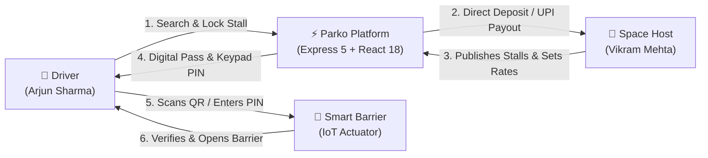
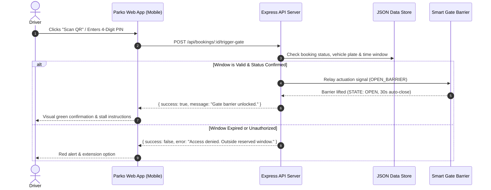

# 🚗 Parko: How It Works — Complete Technical & Functional Architecture

> **Comprehensive guide to the Parko on-demand parking marketplace:** from driver search and IoT smart-barrier actuation to host monetization, atomic data persistence, and security isolation.

---

## 📌 Table of Contents
1. [Executive Summary & Problem Statement](#1-executive-summary--problem-statement)
2. [The Two-Sided Marketplace Model](#2-the-two-sided-marketplace-model)
3. [The Driver Lifecycle: Step-by-Step](#3-the-driver-lifecycle-step-by-step)
4. [The Space Owner Lifecycle: Step-by-Step](#4-the-space-owner-lifecycle-step-by-step)
5. [Smart Gate & IoT Actuation Architecture](#5-smart-gate--iot-actuation-architecture)
6. [System Architecture & Technology Stack](#6-system-architecture--technology-stack)
7. [API Endpoints & Data Contracts](#7-api-endpoints--data-contracts)
8. [Security, Privacy & Confidentiality Shield](#8-security-privacy--confidentiality-shield)

---

## 1. Executive Summary & Problem Statement

In metropolitan Indian cities such as Bengaluru, Mumbai, Delhi-NCR, Pune, and Hyderabad:
- **Drivers waste 20 to 35 minutes on average** circling dense commercial districts searching for parking, generating massive carbon emissions and traffic gridlock.
- **Commercial lots charge exorbitant flat rates** (₹200–₹400 for short visits) with zero guarantee of an open bay upon arrival.
- **Thousands of prime parking spaces sit idle:** residential driveways, corporate lots after business hours, gated society visitor bays, and vacant retail bays.

**Parko solves this problem** by creating an automated, peer-to-peer parking network. Property owners list their unused parking stalls; drivers find and lock guaranteed stalls before arrival, access gated barriers via digital QR passes or dynamic PINs, and pay transparent hourly rates.

---

## 2. The Two-Sided Marketplace Model

Parko balances supply and demand through:
- **Transparent Hourly Billing:** Drivers pay only for the exact window they use, capped by an affordable daily ceiling.
- **10% Parko Guarantee Fee:** Funds the 24/7 host verification, customer dispute resolution, and ₹10,00,000 Host Protection Shield.
- **Guaranteed Stalls:** Once a driver completes a booking, that specific bay (e.g. `Bay A-04`) is removed from the available pool for that window.

---

## 3. The Driver Lifecycle: Step-by-Step

### Step 1: Spatial Discovery (`/explore`)
- **Map & Geocoding:** Drivers browse available parking stalls via Leaflet OpenStreetMap tiles, backed by OpenStreetMap Nominatim geocoding.
- **Live GPS Tracking:** 1-click geolocation locates the user's current coordinates (`lat, lng`) and centers the map around nearby parking options.
- **Multi-Attribute Filters:** Filter by vehicle size (Two-Wheeler, Hatchback, Sedan, SUV), EV Charging, Covered roof, CCTV surveillance, and maximum hourly price.

### Step 2: Spot Detail & Pricing Calculation (`/space/:id`)
- View verified photos, host response times, security badges, and past driver ratings.
- Real-time price breakdown:
  $$\text{Subtotal} = \text{Duration (Hours)} \times \text{Hourly Rate (₹/hr)}$$
  $$\text{Parko Guarantee Fee} = \text{Subtotal} \times 10\%$$
  $$\text{Total Amount} = \text{Subtotal} + \text{Parko Guarantee Fee}$$

### Step 3: Fast Booking & UPI Hold (`/book/:id`)
- Drivers review vehicle details (make, model, license plate number).
- Simulated UPI instant payment prompt or credit card selection.
- Generates a unique booking reference ID (e.g. `PRK-8429-BLR`).

### Step 4: Digital Access Pass & Gate Entry (`/dashboard/driver`)
- Drivers receive an encrypted, time-bound **Digital QR Pass** and a **4-Digit Gate Keypad PIN** (e.g. `4829`).
- When arriving at the destination:
  1. Driver displays the QR code to the barrier scanner, OR enters the PIN on the gate keypad.
  2. The gate validates against the Parko API (`POST /api/bookings/:id/trigger-gate`).
  3. Barrier lifts in under 30 seconds for seamless contactless entry.

### Step 5: Remote Window Extension & Departure
- Drivers can extend their booking window directly from their mobile browser without rushing back to the stall.
- 100% Free Cancellation is supported up to 1 hour prior to scheduled arrival with instant full refund.

---

## 4. The Space Owner Lifecycle: Step-by-Step

### Step 1: 6-Step Guided Listing Wizard (`/list-space`)
1. **Location & Address:** Street, landmark, and automated coordinates pin on OpenStreetMap.
2. **Space Details:** Type (Driveway, Covered Carport, Underground Garage, Open Surface Bay) and maximum supported vehicle sizes.
3. **Amenities & Security:** EV charger capacity (Level 1/2), 24/7 CCTV surveillance, gate attendant presence, and wide SUV clearance.
4. **Pricing:** Custom hourly rate (₹/hr) and 24-hour daily maximum cap.
5. **Photo Uploads:** Multi-angle parking stall photos.
6. **Instant Publish:** Immediately activates on the live marketplace.

### Step 2: Availability & Scheduling Matrix (`/dashboard/owner`)
- Hosts manage a visual **Weekly 7-Day Matrix** (Monday to Sunday, 00:00 to 24:00).
- If the host needs their driveway between 7:00 PM and 9:00 AM on weekdays, they toggle those hours off. The remaining hours are automatically made available to incoming drivers.

### Step 3: Real-Time Arrivals Feed & Remote Actuation
- Hosts view all active and incoming reservations in real time, including driver names, phone contacts, and vehicle plate numbers (`MH 02 CZ 8921`).
- If a barrier requires manual intervention, the host can click **"Trigger Gate Open"** to actuate the gate remotely.

### Step 4: Weekly Automated Direct Payouts
- Host revenue accumulates in their Parko host studio.
- Every Friday, funds are disbursed automatically via direct bank deposit or UPI.
- Every booking is insured under the **₹10,00,000 Parko Host Protection Shield** covering property accidental damage.

---

## 5. Smart Gate & IoT Actuation Architecture

---

## 6. System Architecture & Technology Stack

| Layer | Technologies Used | Purpose |
|---|---|---|
| **Frontend Framework** | React 18, TypeScript, Vite 5 | Reactive component architecture and fast HMR bundling |
| **Interactive Mapping** | Leaflet 1.9, OpenStreetMap Tiles, Nominatim API | Interactive vector maps, city pins, and live GPS geolocation |
| **Styling & Design System** | Tailwind CSS 3, Lucide React Icons | Modern mobility palette, WCAG AAA accessibility, micro-animations |
| **Backend REST API** | Express 5, TypeScript (`tsx`) | High-performance API routing, CORS, and logging |
| **Data Persistence** | Thread-Safe Atomic JSON Database (`server/db/index.ts`) | Zero-configuration portable database with ACID-like atomic writes |
| **Authentication** | Firebase Google OAuth & Dual Guest Personas | Seamless 1-tap Google login + local offline fallback personas |
| **Deployment** | Vercel Serverless & SPA Rewrites (`vercel.json`) | Global edge CDN frontend with serverless `/api` routing |

---

## 7. API Endpoints & Data Contracts

| Method | Route | Description |
|---|---|---|
| `GET` | `/api/health` | API heartbeat, uptime, and database records count |
| `GET` | `/api/spaces` | Query spaces with multi-attribute filtering (`q`, `type`, `maxPrice`, `amenities`, `sortBy`) |
| `GET` | `/api/spaces/:id` | Full details for a single parking spot |
| `POST` | `/api/spaces` | Create and publish a new parking listing |
| `PATCH` | `/api/spaces/:id/rate` | Modify space hourly rate and daily maximum cap |
| `PATCH` | `/api/spaces/:id/toggle` | Pause or resume live listing visibility |
| `GET` | `/api/bookings` | List all bookings for active driver or host |
| `GET` | `/api/bookings/:id` | Digital pass QR seed and 4-digit keypad PIN |
| `POST` | `/api/bookings` | Create verified reservation with 10% guarantee fee |
| `POST` | `/api/bookings/:id/cancel` | Cancel booking with 100% full refund |
| `POST` | `/api/bookings/:id/trigger-gate` | IoT Smart Gate Actuator simulator |
| `POST` | `/api/auth/login` | Driver or host persona authentication |
| `GET` | `/api/metrics/owner` | Space host earnings, occupancy %, and weekly payouts |

---

## 8. Security, Privacy & Confidentiality Shield

- **Zero Hardcoded Secrets in Git:** All confidential tokens and third-party API keys are loaded via Vite environment variables (`import.meta.env.VITE_FIREBASE_*`).
- **Git Exclusions (`.gitignore`):** `.env`, `.env.local`, `.env.*.local`, and `*.env` are strictly blocked from Git commits.
- **Safe Fallback Configuration:** In environments where external API keys are not supplied, Parko automatically activates a resilient offline fallback mode so that core functionality and UI exploration remain completely functional without throwing unhandled exceptions.
- **Data Protection:** Driver identity numbers, phone contacts, and vehicle registration numbers are masked in public endpoints and exposed only to verified space hosts during valid reservation windows.
