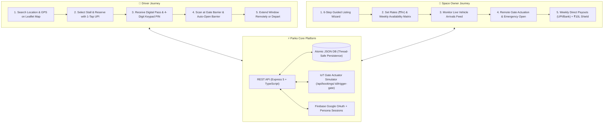

# Parko — Parking on Demand (Frontend Web Application)

> Modern two-sided mobility marketplace connecting urban drivers with guaranteed on-demand parking and empowering property owners to monetize unused parking spaces safely and effortlessly.

Built with **React**, **TypeScript**, **Tailwind CSS**, and **Vite**. Inspired by the design standards of Linear, Stripe, Airbnb, and Uber.

---

## 🧠 How Parko Works (Complete System Walkthrough)

Parko is a two-sided mobility network designed to eliminate urban parking congestion in Indian metros (Bengaluru, Mumbai, Delhi-NCR, Pune, Hyderabad). It connects urban drivers needing guaranteed parking with residential, commercial, and private property owners who have empty stalls, driveways, or carports.

For a full technical deep dive, see the dedicated [HOW_IT_WORKS.md](file:///Users/ayush/Desktop/Parko/HOW_IT_WORKS.md).



### 1. For Drivers: Reserving a Guaranteed Stall in 4 Steps
1. **Search on Live Interactive Map (`/explore`)**:
   - Search by landmark, neighborhood (e.g. *Indiranagar*, *BKC*, *Connaught Place*), or click **"Live GPS"** to pinpoint spots around your current coordinates.
   - Filter by vehicle size (Two-Wheeler, Hatchback, Sedan, SUV), EV Charging, Covered bays, or 24/7 Security guards.
2. **Instant Reservation & UPI Lock (`/space/:id` &rarr; `/book/:id`)**:
   - Choose your arrival and departure times. Parko dynamically calculates duration, hourly rate, and the 10% Parko Guarantee Fee.
   - Confirm via simulated UPI or Card. Your bay is instantly reserved and held exclusively for your license plate.
3. **Contactless Smart Gate Access (`/dashboard/driver`)**:
   - Get turn-by-turn directions to the entrance.
   - The driver portal generates a **Digital Pass** featuring an encrypted QR code and an offline **4-digit Keypad PIN** (e.g. `4829`) to lift automatic barrier gates in under 30 seconds.
4. **Flexible Departure & 1-Tap Extensions**:
   - Running late? Tap "Extend Booking" from your phone to add time without running back to a payment meter.
   - Plans changed? Enjoy a **100% Free Cancellation Policy** with instant full refund.

### 2. For Property Owners: Monetizing Space Effortlessly
1. **List in Under 3 Minutes (`/list-space`)**:
   - Use our 6-step guided wizard to specify location, address, vehicle clearances, and upload photos.
   - Location is automatically geocoded onto OpenStreetMap coordinates.
2. **Dynamic Rates & Weekly Schedule Matrix (`/dashboard/owner`)**:
   - Configure hourly rates (e.g. `₹50 - ₹120/hr`) and daily maximum caps.
   - Use the **Weekly Stall Availability Matrix** to reserve certain hours for personal family use while letting Parko monetize empty downtime.
3. **Automated IoT Access & Live Arrival Feed**:
   - Time-bound dynamic PINs prevent unauthorized parking.
   - View scheduled arrivals in real time with driver vehicle make, model, and plate number (`MH 02 CZ 8921`), with a one-click manual "Trigger Gate Open" actuator button.
4. **Weekly Guaranteed Deposits & Host Protection Shield**:
   - Earnings accumulate transparently and are deposited directly to your bank account or UPI every Friday.
   - Every single booking is protected by the **₹10,00,000 Parko Property Protection Guarantee**.

---

## 🚀 Key Features & Pages

### 1. Marketing Landing Page (`/`)
- **Hero & Search Engine**: "Your parking spot. Just a tap away." Interactive search bar supporting location, date, arrival, and departure filters.
- **Value Metrics**: Transparent stats (4.94★ average rating, < 30s QR gate check-in, up to 45% savings, $1M host guarantee).
- **Featured Parking Spots**: Real-time spots with pricing, distance to transit hubs, and instant reservation actions.
- **4-Step Booking Guide**: Search & Select &rarr; Instant Reserve &rarr; Navigate & Scan &rarr; Extend or Depart.
- **Two-Sided Marketplace Value Cards**: Dedicated benefits for Drivers vs. Space Owners.
- **Interactive Host Earnings Calculator**: Projected monthly revenue simulator with real-time sliders (stalls, hours/day, hourly rate).
- **Safety Highlights & FAQ Accordion**: Interactive questions and answers.

### 2. Explore Parking Page (`/explore`)
- **Live Search & Multi-Filter Bar**: Real-time filtering by neighborhood query, parking type, price sliders, vehicle compatibility, and amenities.
- **Interactive Vector Map**: Illustrative downtown map with active price pins, hovering previews, and synchronized spot selection.
- **Dual View Modes**: Switch seamlessly between **Split View** (list + map), **Grid List View**, and **Full Map View**.
- **Sorting**: Lowest price, highest price, highest rating, and spot availability.

### 3. Space Details Page (`/space/:id`)
- **Image Gallery**: High-res photo gallery with interactive thumbnail switcher.
- **Dynamic Price Calculator**: Instant calculation of duration, subtotal, 10% Parko guarantee fee, and total amount.
- **Comprehensive Amenities**: CCTV 24/7, EV charging, 24/7 access, wide SUV stalls, and gate keypad codes.
- **Verified Host Profile**: Response rate, rating, and host verification status.
- **Driver Feedback**: Simulated verified reviews.

### 4. Driver Booking Journey (`/book/:id`)
- **Step 1**: Schedule confirmation (date, arrival, departure) and driver/vehicle information (license plate, make/model).
- **Step 2**: Simulated driver's license upload with file size and format validation, plus simulated payment method selection (Credit Card, Apple Pay, Google Pay).
- **Step 3**: Instant booking confirmation with reference (e.g. `PRK-8429-SF`), digital QR access pass, gate keypad PIN, and 1-tap addition to the Driver Dashboard.

### 5. Driver Dashboard (`/dashboard/driver`)
- **Upcoming Passes**: Countdown, gate PINs, and full-screen digital QR pass modal for smart barrier entry.
- **Free Cancellation Flow**: 1-click simulated cancellation with full refund status.
- **Booking History**: Past reservations with re-booking shortcuts.
- **Saved Favorites**: Instant access to favorited parking spots.
- **Vehicle & Verification Management**: Editable primary vehicle license plate for automated ALPR gate recognition.

### 6. Space Owner Dashboard (`/dashboard/owner`)
- **Performance Overview**: Estimated monthly revenue, space occupancy rate (%), active listings, and upcoming Friday direct deposits.
- **Listing Management**: Pause/resume listing visibility, edit hourly rates inline, view live listings, and delete listings.
- **Today's Scheduled Arrivals**: Real-time vehicle check-in feed with simulated "Trigger Gate Open" controls.
- **Weekly Stall Availability Matrix**: Visual 7-day schedule of reserved vs. open hours.
- **Earnings Statement**: Simulated direct deposit statement.

### 7. Create Parking Listing Wizard (`/list-space`)
- Guided 6-step wizard:
  1. Location & Address
  2. Space details & Vehicle sizes
  3. Amenities & Security features
  4. Pricing ($/hr, daily cap) & Gate instructions
  5. Photo selector & Custom upload
  6. Review & Instant publish to the marketplace

### 8. Trust & Safety Center (`/safety`)
- Full breakdown of the 4 pillars of trust: Property Verification, Driver License Checks, Automated Smart Access, and $1,000,000 Host Protection Shield.
- Transparent distinction between the interactive prototype environment and production hardware/payment integrations.

### 9. Interactive Prototype & Persona Switcher
- A persistent prototype banner allows switching between **Driver Mode (Arjun Sharma)** and **Owner Mode (Vikram Mehta)** at any time.

---

## 🛠️ Tech Stack & Architecture

### Frontend
- **Framework**: React 18 + TypeScript + Vite 5
- **Styling**: Tailwind CSS with custom mobility palette (deep navy `#0F172A`, emerald accent `#10B981` / `#059669`, warm neutrals)
- **Icons**: Lucide React
- **Routing**: React Router DOM v7
- **API Client**: Strongly-typed `src/services/api.ts` with Vite development proxy (`/api` &rarr; `http://localhost:5000`) and graceful fallback.

### Backend (Production-Grade Node.js + Express API)
- **Server**: Express 5 + TypeScript (`tsx`)
- **Storage**: Atomic thread-safe JSON database with auto-seeding (`server/data/parko-db.json`)
- **Middleware**: CORS, request duration logger, centralized error handling
- **Testing**: Automated end-to-end integration test runner (`npm run test:api`)

---

## 📡 Backend API Endpoints

| Method | Endpoint | Description |
|---|---|---|
| `GET` | `/api/health` | Service status, uptime, and database records count |
| `GET` | `/api/spaces` | Query spaces with multi-parameter filtering (`q`, `type`, `maxPrice`, `vehicleSize`, `amenities`, `sortBy`) |
| `GET` | `/api/spaces/:id` | Retrieve single parking space details |
| `POST` | `/api/spaces` | Create & publish a new parking space listing |
| `PATCH` | `/api/spaces/:id/rate` | Adjust space hourly rate and daily maximum cap |
| `PATCH` | `/api/spaces/:id/toggle` | Toggle listing live visibility (active / paused) |
| `POST` | `/api/spaces/:id/reviews` | Submit verified driver review and recalculate rating |
| `GET` | `/api/bookings` | List active, confirmed, and past reservations |
| `GET` | `/api/bookings/:id` | Get booking pass, gate code, and digital QR seed |
| `POST` | `/api/bookings` | Create verified reservation with 10% guarantee fee |
| `POST` | `/api/bookings/:id/cancel` | Cancel reservation with 100% refund policy |
| `POST` | `/api/bookings/:id/trigger-gate` | IoT Smart Gate Actuator simulator for verified vehicle |
| `POST` | `/api/auth/login` | Driver / Owner persona authentication |
| `PUT` | `/api/auth/vehicle` | Update primary vehicle make & license plate |
| `GET` | `/api/metrics/owner` | Space host earnings, occupancy rate, and weekly payouts |
| `GET` | `/api/metrics/platform` | Platform-wide parking metrics and stats |

---

## 💻 Local Development Setup

### Prerequisites
- Node.js `^20.11.0` or higher
- npm `^10.0.0` or higher

### Installation & Run

```bash
# 1. Clone repository & enter directory
cd Parko

# 2. Install dependencies
npm install

# 3. Option A: Run Fullstack (Backend + Frontend simultaneously)
npm run dev:all

# 3. Option B: Run separately
npm run server    # Starts backend API on http://localhost:5000
npm run dev       # Starts Vite frontend on http://localhost:5173
```

Open [http://localhost:5173/](http://localhost:5173/) in your web browser.

### Run Automated Backend API Tests

```bash
npm run test:api
```

Executes 10 automated integration tests covering health, listing discovery, booking creation, gate triggering, and cancellation.

### Production Build & Typecheck

```bash
npm run build
```

Compiles both frontend and backend TypeScript types and builds production static bundle in `dist/`.

